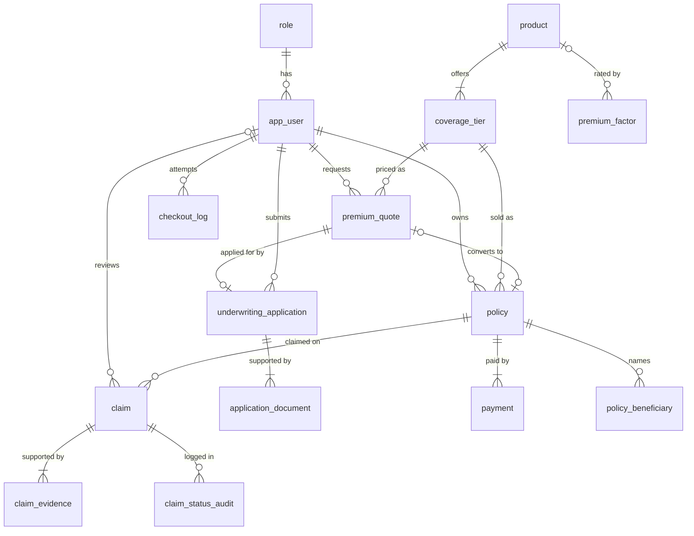

# BIB Assurance: Online Insurance Management System

A full-stack web application for a fictional Thai insurer, built as the final group project for *Database Programming* at Chulalongkorn University (2026).

Customers can get a quote, apply, pay and claim online. Claims officers review applications and claims, and administrators track the business on a KPI dashboard. The business rules live in the MySQL database itself (constraints, triggers, stored procedures and transactions), so bad data is rejected no matter which page sends it.

> BIB Assurance is fictitious: no real policies, customers or payments. Every person, e-mail address (`@bib.test`) and phone number in the sample data is invented.

## Highlights

- **End-to-end insurance journey:** premium calculator → quotation with a 7-day price lock → underwriting application with document upload → officer decision → payment → policy → claim → assessment.
- **5 products** (health, critical illness, life, personal accident, retirement) and **3 roles** (customer, claims officer, administrator).
- **Database layer:** 15 tables, 7 functions, 18 triggers, 9 views and 15 stored procedures.
- **All-or-nothing checkout:** the policy, payment, quotation update and checkout log are one transaction, so a declined card rolls everything back.
- **Management dashboard (Chart.js):** net written premium, benefits paid, loss ratio, policies by product and customer age, and claims by status.

## Tech stack

| Layer | Tools |
|---|---|
| Database | MySQL 8.0.16+ (MySQL Workbench) |
| Backend | Python, Django 4.2 (function-based views; raw SQL through `connection.cursor()` and `callproc()`) |
| Frontend | Bootstrap 5.3, Bootstrap Icons, Chart.js 4 (loaded from a CDN) |
| Security | PBKDF2 password hashes; only the last 4 card digits are stored; secret key and DB credentials read from environment variables |

## Project structure

```
bib-assurance/
├── manage.py
├── requirements.txt
├── .env.example          # environment variables to set before running
├── projectweb/           # settings, URLs, DB helper, sign-in/role decorators, upload helper
├── accounts/             # sign-in, registration, profile, staff users, beneficiaries
├── catalog/              # products, coverage tiers, rating factors, quotations (+ shared layout and static files)
├── checkout/             # underwriting applications, review queue, payment and checkout log
├── policies/             # policy list, live status, cancellation (14-day free look)
├── claims/               # claim submission, evidence, officer assessment, status timeline
├── analytics/            # management dashboard and reports
├── database/
│   ├── 01_schema.sql     # tables, keys, CHECK constraints, indexes
│   ├── 02_routines.sql   # functions, triggers, views, stored procedures
│   ├── 03_seed_data.sql  # sample data (generated by tools/make_seed.py)
│   └── tools/            # seed and SVG generators
└── media/                # sample line-art images (SVG) used by the seed data
```

## Business rules enforced in the database (selection)

| Rule | Enforced by |
|---|---|
| No payment and no policy without an approved underwriting application | `sp_checkout_policy` guard + `trg_policy_before_insert` |
| Policy, payment, quotation and log are saved together or not at all | `sp_checkout_policy` transaction with `ROLLBACK` handler |
| Quotation price is locked for 7 days; checkout charges the stored price only | `premium_quote`, `sp_checkout_policy` |
| Approved claim amount ≤ claimed amount − deductible and ≤ remaining benefit | `trg_claim_before_update`, CHECK constraints |
| Approving a claim deducts the payout from the policy's remaining coverage | `trg_claim_after_update` |
| Beneficiary shares must total exactly 100% (max 4 beneficiaries) | `trg_beneficiary_before_insert/update`, `sp_save_beneficiaries` |
| Every claim status change is audited | `trg_claim_after_insert`, `trg_claim_after_update_audit` |
| Cancel with a full refund only within 14 days and with no claims | `sp_cancel_policy` transaction |
| Payments are never edited or deleted; only the last 4 card digits are stored | payment triggers, CHECK `check_payment_card` |

Trigger messages are written for customers (`SIGNAL SQLSTATE '45000'`), and constraint errors are translated into plain sentences in `projectweb/dbhelper.py`, so table and constraint names never appear on a page.

### Premium formula (`fn_calc_premium`)

```
premium = base annual premium × (sum insured ÷ minimum coverage) × age factor × class factor × (months ÷ 12)
```

## Data model



## Run it locally

1. **Install:** Python 3.10+, MySQL 8.0.16+ and MySQL Workbench.
2. **Create the database:** in MySQL Workbench, run these scripts in order: `database/01_schema.sql` → `database/02_routines.sql` → `database/03_seed_data.sql`. (`01` drops and re-creates the `bibdb` database.)
3. **Set environment variables** (see `.env.example`). Windows PowerShell:
   ```powershell
   $env:DB_PASSWORD = "your-mysql-password"
   $env:DJANGO_SECRET_KEY = "any-long-random-string"
   ```
   macOS / Linux: `export DB_PASSWORD="..."` and `export DJANGO_SECRET_KEY="..."`
4. **Install the packages and start the site:**
   ```bash
   python -m venv venv
   venv\Scripts\activate          # macOS / Linux: source venv/bin/activate
   pip install -r requirements.txt
   python manage.py migrate       # creates Django's own session/admin tables inside bibdb
   python manage.py runserver
   ```
5. **Open the site:** go to http://127.0.0.1:8000/. You need an internet connection for the Bootstrap and Chart.js CDNs.

### Demo accounts (local sample data only)

All sample accounts use the password `Bib@2026`.

| Role | E-mail | Try this |
|---|---|---|
| Administrator | `admin@bib.test` | Dashboard, reports, products and rating factors, users |
| Claims officer | `pim@bib.test` | Application queue and claim queue with document viewers |
| Customer | `somchai@bib.test` | Policies with approved and declined claims, beneficiaries |
| Customer | `tawan@bib.test` | New account: run the full flow from quote to payment |

Mock payment cards: `4242 4242 4242 4242` is approved, and `4000 0000 0000 0002` is declined (the whole checkout rolls back).

## Team

A team of 6 built this project. Each member owned one Django app and its database objects.
